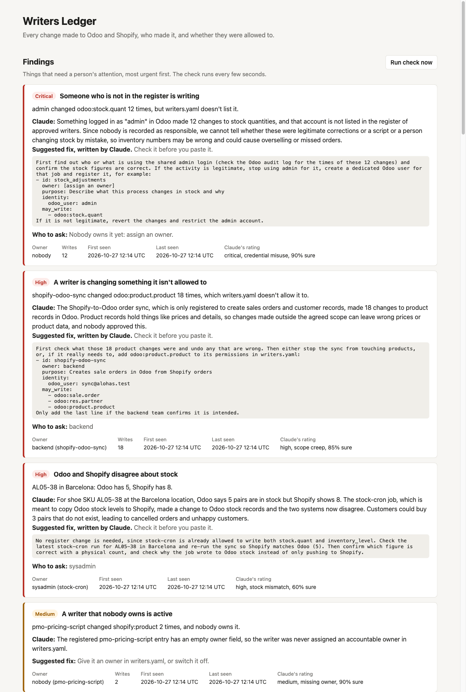
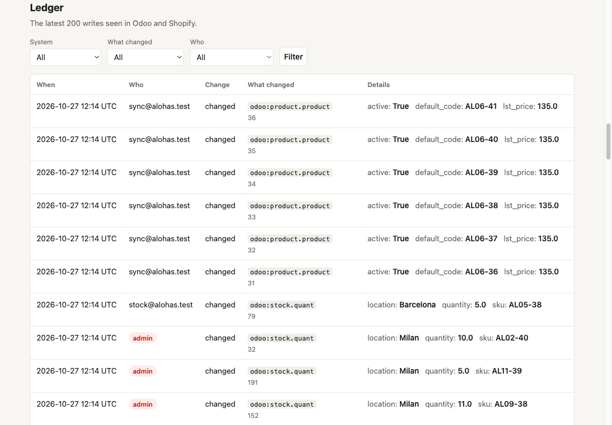

# Writers Ledger

[](https://github.com/luodaint/writers-ledger/actions/workflows/ci.yml)

Every write into Odoo and Shopify lands in a ledger, gets matched against
`writers.yaml`, and anything unknown, out of scope or ownerless becomes a finding,
explained in plain words.

> Work in progress: phases 1 to 3 of 4 are done. Phase 4 adds `make reset`, the
> cost per check run and the case's questions, answered here.

**Docs:** [what it does](docs/overview.md) · [install and run](docs/install.md) ·
[test data](docs/data.md) · [the register](docs/register.md) ·
[findings and triage](docs/findings.md) · [security](docs/security.md) ·
[what it can't see](docs/limits.md) · [develop](docs/development.md)

## What it looks like

These screenshots come from the offline demo (`make up`, `make seed`, `make traffic`)
with triage on.

**Findings**, most urgent first. The rules decide what is wrong. Claude rates each
finding, and explains the high and critical ones in plain words with a fix to paste.



**Writers** shows the register and what each writer did. Anyone seen writing who isn't
in the register comes first, in red.


**Ledger** shows the latest writes seen in Odoo and Shopify, here filtered to
Shopify. Each filter lists only what the other filters leave, with a count, and
applies as soon as you pick it. Click a system, writer or model in a row to filter
by it.



## Run it offline

```sh
make up        # Postgres, Odoo 19, a fake Shopify and the app (first boot ~2 min)
make seed      # Odoo bot users with their own API keys, 15 shoes x 6 sizes, 3 shops, stock
make traffic   # three simulated days of writes from every writer, plus four planted incidents
```

Open <http://127.0.0.1:8000> and log in as `reviewer` / `local-only-demo`. The
ledger fills within 10 seconds of the traffic. Odoo is at <http://127.0.0.1:8069>
(`admin` / `local-only-admin`). These defaults only work offline: every port is
bound to `127.0.0.1`. Change them in `.env` (see `.env.example`). Settings, triage
and troubleshooting: [Install and run](docs/install.md).

## The demo: four findings, and the register is the fix

About a minute after `make traffic`, the page shows four findings:

| Severity | Finding | What happened |
|---|---|---|
| High | Someone who is not in the register is writing | A forgotten cron uses the Odoo **admin** key to reset Milan stock every night. |
| High | A writer is changing something it isn't allowed to | `shopify-odoo-sync` started writing product prices in Odoo. |
| Medium | A writer that nobody owns is active | `pmo-pricing-script` updates products, and its owner is empty. |
| High | Odoo and Shopify disagree about stock | One stock push sent Barcelona 3 pairs too many of `AL05-38`. |

Below them, a grey note counts the Shopify stock changes that nobody can be blamed
for: Shopify doesn't say which app changes inventory.

The sync wrote 3 prices but the finding says 18 writes. Odoo keeps a shoe's price on
the shoe, so changing it updates all six of its sizes, and the ledger counts what
Odoo records.

Now fix the register. Open `writers.yaml` and:

1. Give `pmo-pricing-script` an owner: `owner: pmo`.
2. Register the cron, with an owner who will replace the admin key with a bot of its own:

   ```yaml
   - id: milan-stock-reset
     owner: sysadmin
     purpose: Nightly Milan stock reset. Move it off the admin key.
     identity: { odoo_user: admin }
     may_write: [odoo:stock.quant]
   ```

3. Press **Run check now** (or `make check`). Both findings move to *Resolved*.
   No restart: every check re-reads `writers.yaml`. A half-saved, broken file pauses
   the checks and shows the problem on the page; nothing resolves until it's fixed.

The other two are fixed outside the register. Take the product rights away from
the sync bot in Odoo, or, if it should write prices, add `odoo:product.product` to
its `may_write`. Correct the Barcelona stock. To kill the cron instead of
registering it, revoke its key: the finding resolves when its last write is older
than the 7-day window.

## Test it with other data

Odoo in the demo is real Odoo 19; only Shopify is faked. Three ways to go further,
in full in [Test data](docs/data.md):

**1. More, or different, data.** `make traffic` doesn't pass settings through, so
run the container directly:

```sh
docker compose -f docker-compose.fake.yml run --rm -T -e TRAFFIC_DAYS=30 -e TRAFFIC_SEED=42 traffic
```

`TRAFFIC_DAYS` sets the simulated days (default 3), so 30 gives about ten times the
writes, all inside the 7-day window. `TRAFFIC_SEED` picks different SKUs, customers
and orders. Running it again adds to what's there: the same findings come back
with higher counts. To start from zero, run
`docker compose -f docker-compose.fake.yml down --volumes`, then `make up seed traffic`.

**2. Be a writer yourself.** The most convincing test, with no scripted data:

1. Log in to Odoo at <http://127.0.0.1:8069> as `admin` (`ODOO_ADMIN_PASSWORD`, or
   `local-only-admin`).
2. Open a shoe, change its **Sales Price** and save.
3. Within about 10 seconds, a new finding for `admin` on `odoo:product.product`
   appears, with 6 writes, one per size: `unknown_writer`, or `out_of_scope` if you
   already registered `admin` in the demo above. With triage on, Claude rates it.
4. Allow it in `writers.yaml` and press **Run check now**: the finding resolves.
   After the demo, add `odoo:product.product` to the `may_write` of its `admin`
   entry; on a fresh demo, add an entry for `admin`. An identity can belong to one
   writer only, so never add a second one.

**3. A real Shopify dev store, still on your machine.** Not built yet. The real
Shopify API would answer "who made this change" instead of the fake copying it. It
takes a dev store with three apps, a seed for the Shopify catalogue, webhook
registration, and a tunnel such as cloudflared or ngrok, because Shopify only sends
webhooks to a public HTTPS address. Expect it to confirm what the demo shows: the
fake already follows the real API's limits.

## How it works

Odoo is polled with a read-only key, and Shopify sends signed webhooks. Each change
becomes a write in the ledger, without customer data. After every poll, a check
applies four rules to the ledger and `writers.yaml`, with no AI involved:
`unknown_writer`, `out_of_scope`, `ownerless_writer` and `stock_drift`. Repeats
collapse into one finding with a count.

Claude then rates every finding with `claude-haiku-5-5`, and explains the high and
critical ones with `claude-sonnet-5-5`: plain sentences, a fix to paste and who to
ask. The rule's severity is a floor Claude can raise but never lower, and no
customer data reaches it. A first triage of the demo's four findings costs about
**$0.015**.

More: [findings and triage](docs/findings.md), [security](docs/security.md),
including how the Odoo API keys are handled, and
[what the ledger can and can't see](docs/limits.md).

## Develop

```sh
make test    # Python 3.12 venv via uv, then pytest
make lint    # ruff
make smoke   # after `make up seed traffic`: every writer is in the ledger, no customer data
make eval    # Claude's triage on evals/cases.yaml (needs ANTHROPIC_API_KEY in .env)
make loc     # app code line count
make help    # all targets
```

`main` only changes through pull requests. CI runs lint and tests, then the whole
offline demo end to end (`make up seed traffic smoke`); both checks and CodeQL must
pass before a merge. More: [Develop](docs/development.md). Report vulnerabilities
privately: see [SECURITY.md](SECURITY.md).

Spec: [`docs/brief.md`](docs/brief.md). Rules for coding agents:
[`AGENTS.md`](AGENTS.md). How the AI assistant was used:
[`docs/ai-log.md`](docs/ai-log.md).
